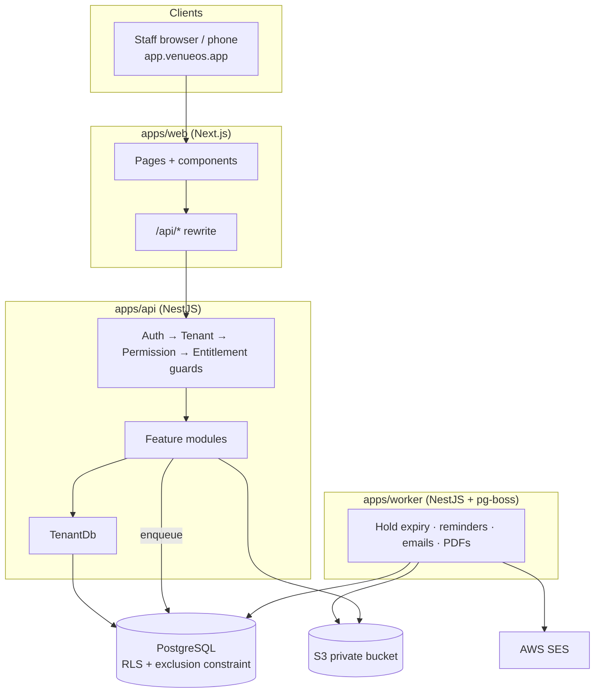

# 02 — System design

## Overview

One TypeScript monorepo, three deployable apps, one PostgreSQL database shared by all
tenants. Tenant isolation is enforced in three layers: API guards, a tenant-scoped database
client, and PostgreSQL Row Level Security (RLS).

## Apps and packages

| Unit | Responsibility | Must not |
| --- | --- | --- |
| `apps/web` | UI, routing, forms, client-side state, i18n, calls API through `packages/api-client` | Hold business logic, talk to the database, hold secrets |
| `apps/api` | Auth, authorization, validation, business logic, transactions, OpenAPI | Do slow work in the request (emails, PDFs): enqueue a job instead |
| `apps/worker` | Scheduled and queued jobs, email sending, PDF rendering | Expose HTTP endpoints (except a health check) |
| `packages/db` | Prisma schema, migrations, SQL, `TenantDb`, seed | Contain business rules |
| `packages/shared` | Zod schemas, enums, permission names, money/date helpers | Import Node-only or server code (it ships to the browser) |
| `packages/api-client` | Generated types + fetch client | Be edited by hand |
| `packages/templates` | Email/PDF HTML templates with escaped variables | Fetch data itself |

## URLs and domains

`venueos.app` is a placeholder until the product domain is bought.

| URL | Serves | Notes |
| --- | --- | --- |
| `app.venueos.app` | Staff dashboard (all tenants, tenant switcher) | Next.js; `/api/*` is rewritten to the API, so the browser sees one origin |
| `api.venueos.app` | API for future mobile app and public API | Bearer tokens only; not used by the web app in MVP |
| `{slug}.venueos.app` | Phase 2: customer portal, public booking page | Tenant resolved with `resolve_tenant(host)` |
| `admin.venueos.app` | Platform admin (internal) | Separate login, IP allowlist |

Why the `/api` rewrite: the session cookie stays host-only on `app.venueos.app`
(`__Host-` prefix), no CORS is needed, and CSRF exposure is smaller.

## Request lifecycle (staff request)

1. Browser calls `app.venueos.app/api/v1/bookings` with the `__Host-vos_session` cookie.
2. Next.js rewrites to the API's internal URL, forwarding cookie and client IP.
3. `AuthGuard`: hash the cookie token, load a non-revoked, non-expired `auth_sessions` row,
   slide `lastSeenAt`. Fail → 401.
4. `TenantGuard`: read `activeTenantId` from the session, load the membership + role for
   that user and tenant, check the membership is active and the tenant is not suspended.
   Store `{ userId, tenantId, membershipId, permissions, venueIds, limits }` in CLS
   (`nestjs-cls`). Fail → 403.
5. `PermissionGuard`: the handler's `@RequirePermission()` must be in the role. Fail → 403.
6. `EntitlementGuard` (only on create endpoints that consume plan limits). Fail → 402
   `PLAN_LIMIT_REACHED`.
7. Zod validation pipe on params, query, body. Fail → 400 `VALIDATION_ERROR`.
8. Service runs inside `tenantDb.tx(async (db) => ...)`, which opens a transaction and runs
   `set_config('app.tenant_id', ..., true)` and `set_config('app.user_id', ..., true)` first.
   RLS now applies to every statement.
9. Audit rows are written in the same transaction. Jobs are enqueued in the same transaction
   (pg-boss uses the same database), so a rolled-back booking never sends an email.
10. Errors are mapped to the standard error format (see `06-api-conventions.md`).

## Multi-tenancy

- Shared database, shared schema, `tenant_id` on every tenant-owned table.
- RLS policies are created by `packages/db/prisma/sql/001_constraints_and_rls.sql` for every
  table that has a `tenant_id` column. A new table with `tenant_id` gets the policy when the
  SQL block is re-run in its migration (see `03-data-model.md`).
- Before a tenant is chosen (login, tenant switcher), the app sets only `app.user_id`; the
  `membership_self` and `tenant_visible` policies let the user see their own memberships and
  tenants and nothing else.
- Public pages (Phase 2) resolve the tenant from the host with the `resolve_tenant()` SQL
  function, the only way to read `tenants` without context.
- Database roles:
  - `venueos_migrator`: owns the schema, runs migrations. Never used by running apps.
  - `venueos_app`: used by api and worker for tenant work. No `BYPASSRLS`.
  - `venueos_jobs`: `BYPASSRLS`, used only by the worker's scanners that find due work across
    tenants (expiring holds, due reminders). The scanner reads IDs only and enqueues one job
    per tenant item; the job itself runs as `venueos_app` inside that tenant's context.

## Booking engine (summary; full rules in `05-business-rules.md`)

- Booking = contract with one customer. Session = one space + one time range (+ slot,
  event type, package, guests). One booking holds many sessions.
- Occupancy rows: one per physical space a session blocks, time range including setup and
  cleanup buffers. A combined space writes one row per component space.
- The `space_occupancies_no_overlap` exclusion constraint rejects overlapping active rows for
  the same space. The `bookings_sync_occupancy` trigger activates/deactivates rows when the
  booking status changes.
- Pricing is computed on the server by `PricingService.quote(input)` and stored as frozen
  `booking_line_items`. The client never sends prices.

## Background jobs (apps/worker, pg-boss)

| Job | Trigger | Does |
| --- | --- | --- |
| `holds.expire` | Every 5 min scanner | Sets TENTATIVE bookings past `holdExpiresAt` to EXPIRED (trigger frees the slots), emails the agent |
| `reminders.payment-due` | Daily 09:00 venue time | Emails customers with schedule items due in N days; marks `reminded` |
| `reminders.event` | Daily | Event reminder to customer N days before; event sheet email to ops staff the day before |
| `leads.follow-up` | Every 15 min | Internal email to assignee when `nextFollowUpAt` passes |
| `email.send` | Enqueued by API | Renders template, sends via SES, writes `message_logs` |
| `pdf.render` | Enqueued by API | Renders quotation / receipt / event sheet HTML to PDF (headless Chromium), stores in S3 |
| `inventory.low-stock` | Daily | Internal email when stock on hand < `reorderLevel` |

Rules: jobs are idempotent (safe to run twice), carry `tenantId` in the payload, retry with
backoff (max 5), and failures land in a dead-letter queue visible in the admin panel.

## Documents and email

- PDFs: HTML templates in `packages/templates`, rendered by headless Chromium (Playwright) in
  the worker. Chromium shapes Urdu (Nastaliq/Naskh fonts) and RTL correctly; bundle the fonts.
- Email: `EmailProvider` interface with an SES implementation (Mailpit SMTP in development).
  Sender is `bookings@venueos.app` with the tenant name as display name and the tenant's
  email as `Reply-To` until custom sending domains exist.
- Files (venue photos, expense bill photos, generated PDFs) go to a private S3 bucket under
  `tenants/{tenantId}/...`; the browser gets short-lived pre-signed URLs only.

## Frontend structure (apps/web)

- App Router with route groups: `(auth)` for login/invite/reset, `(app)` for the dashboard.
- `src/features/<module>/` holds components, hooks and query keys per module.
- Server state with TanStack Query through `packages/api-client`; forms with react-hook-form +
  the same Zod schemas the API uses.
- Calendar: custom grid (spaces as rows, dates as columns, slots as cells). Do not use
  FullCalendar's paid resource views.
- i18n with next-intl: `en` and `ur`; RTL layout via `dir` and logical CSS properties
  (`ms-*`, `me-*`), never hard-coded left/right.
- Mobile-first: every screen must work at 360 px width; the event sheet has a print layout.

## Observability

- Structured JSON logs (pino) with `requestId`, `tenantId`, `userId`; PII redaction list.
- Sentry for api, worker and web errors (PII scrubbing on).
- Health endpoints: `GET /health` (liveness), `GET /health/ready` (DB + queue).
- Key metrics: request latency p95, job failures, emails bounced, holds expired per day.
