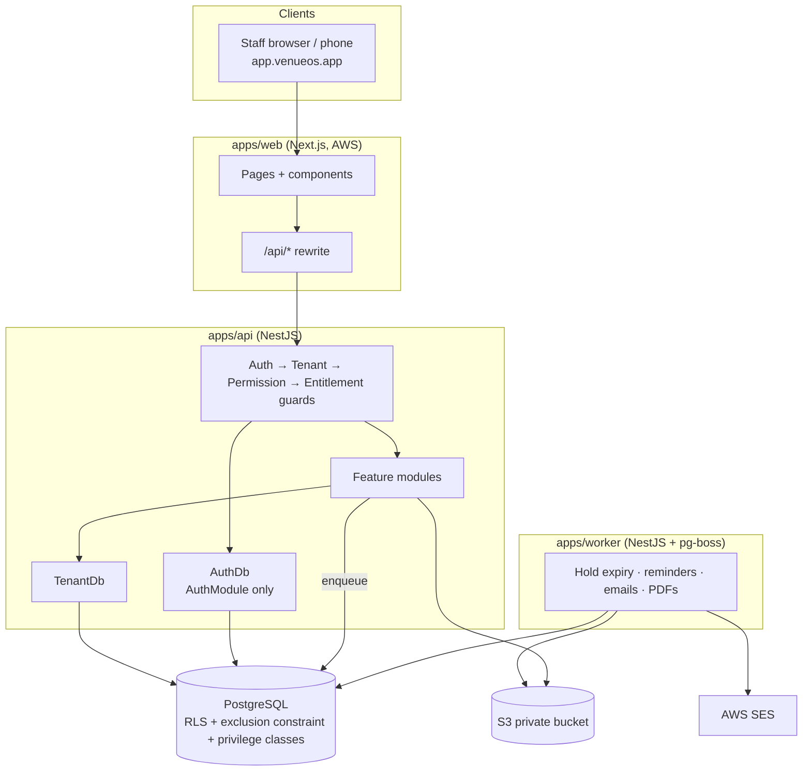

# 02 — System design

## Overview

One TypeScript monorepo, three deployable apps, one PostgreSQL database shared by all
tenants. Tenant isolation is enforced in three layers: API guards, a tenant-scoped database
client, and PostgreSQL Row Level Security (RLS).

## Apps and packages

| Unit | Responsibility | Must not |
| --- | --- | --- |
| `apps/web` | UI, routing, forms, client-side state, i18n, calls API through `packages/api-client` | Hold business logic, talk to the database, hold secrets |
| `apps/api` | Auth, authorization, validation, business logic, transactions, OpenAPI | Do slow work in the request (emails, PDFs): enqueue a job instead |
| `apps/worker` | Scheduled and queued jobs, email sending, PDF rendering | Expose HTTP endpoints (except a health check) |
| `packages/db` | Prisma schema, migrations, SQL, `TenantDb`, `AuthDb`, `pgboss-adapter.ts`, seed | Contain business rules |
| `packages/shared` | Zod schemas, enums, permission names, money/date helpers, currency map, `TenantSettings` | Import Node-only or server code (it ships to the browser) |
| `packages/api-client` | Generated types + fetch client | Be edited by hand |
| `packages/templates` | Email/PDF HTML templates with escaped variables | Fetch data itself |

## URLs and domains and hosting

`venueos.app` is a placeholder until the product domain is bought.

| URL | Serves | Notes |
| --- | --- | --- |
| `app.venueos.app` | Staff dashboard (all tenants, tenant switcher) | Next.js running on AWS (ECS) next to the API in the same VPC; `/api/*` is rewritten to the API's **internal** URL, so the browser sees one origin |
| `api.venueos.app` | **Reserved** for the future mobile app and public API | Bearer tokens only; not deployed in the MVP, so the API has no public listener |
| `{slug}.venueos.app` | Phase 2: customer portal, public booking page | Tenant resolved with `resolve_tenant(host)` |

The platform admin app (`admin.venueos.app`) is post-MVP (see `01-product-scope.md`).

Why the `/api` rewrite: the session cookie stays host-only on `app.venueos.app`
(`__Host-` prefix), no CORS is needed, and CSRF exposure is smaller. The web app is not hosted
on Vercel in the MVP because Vercel cannot reach a private API; the API stays unreachable from
the internet.

Local development: browsers treat `http://localhost` as a secure context for the `Secure`
`__Host-` cookie (Chrome/Edge/Firefox). Safari does not; use Chrome for local work or serve
dev over HTTPS.

## Request lifecycle (staff request)

1. Browser calls `app.venueos.app/api/v1/bookings` with the `__Host-vos_session` cookie.
2. Next.js rewrites to the API's internal URL, forwarding cookie and client IP.
3. `AuthGuard` asks the `AuthContextProvider` who is calling and stores `AuthContext
   { userId, sessionId, activeTenantId }` in CLS. The real provider (`SessionAuthContextProvider`, through
   `AuthDb`) hashes the cookie token, loads a non-revoked `auth_sessions` row, enforces the 12 h idle and 30 day
   absolute limits and slides `last_seen_at` (at most once a minute). No cookie or a revoked token → 401
   `UNAUTHENTICATED`; expired → 401 `SESSION_EXPIRED`.
   Routes marked `@AuthenticatedOnly()` (`/me`, tenant switch, logout, accepting an invitation as an existing
   user) stop here: steps 4 and 5 are skipped because there may be no active tenant yet.
4. `TenantGuard`: read `active_tenant_id` from the session, then in a short `TenantDb` read
   with `app.user_id` and `app.tenant_id` set, load the membership + role for that user and
   tenant, check the membership is active and the tenant status. Store
   `{ userId, tenantId, membershipId, permissions, venueIds, limits }` in CLS (`nestjs-cls`).
   Fail → 403. A `SUSPENDED` tenant is **read-only**: `GET` passes, any other method fails
   with `403 TENANT_SUSPENDED`. `CANCELLED` tenants fail every request with 403.
5. `PermissionGuard`: the handler's `@RequirePermission()` must be in the role. Fail → 403.
6. `EntitlementGuard` (only on create endpoints that consume plan limits). Fail → 402
   `PLAN_LIMIT_REACHED`.
7. Zod validation pipe on params, query, body. Fail → 400 `VALIDATION_ERROR`.
8. Service runs inside `tenantDb.tx(async (db) => ...)`, which opens a transaction and runs
   `set_config('app.tenant_id', ..., true)` and `set_config('app.user_id', ..., true)` first.
   RLS now applies to every statement.
9. Audit rows are written in the same transaction. Jobs are enqueued in the same transaction
   (pg-boss uses the same database, through `packages/db/src/pgboss-adapter.ts`), so a
   rolled-back booking never sends an email. Modules do this with `EmailOutbox.enqueue(tx, ...)`
   (API) / `enqueueEmail` (`@venueos/db`): it appends the `queued` row to `message_logs` and sends
   the job `{ tenantId, messageKey }` in that same transaction.
10. Errors are mapped to the standard error format (see `06-api-conventions.md`).

## Multi-tenancy

- Shared database, shared schema, `tenant_id` on every tenant-owned table.
- RLS policies are created by `packages/db/prisma/sql/001_constraints_and_rls.sql` for every
  table that has a `tenant_id` column. A new table with `tenant_id` gets the policy by calling
  `enable_tenant_rls()` in its migration (see `03-data-model.md`).
- Before a tenant is chosen (login, tenant switcher), the app sets only `app.user_id`; the
  `membership_self` and `tenant_visible` policies let the user see their own memberships and
  tenants and nothing else. `users` is visible to the app as: your own row, plus users with a
  membership in the current tenant.
- Public pages (Phase 2) resolve the tenant from the host with the `resolve_tenant()` SQL
  function, the only way to read `tenants` without context. It is `SECURITY DEFINER`, owned by
  `venueos_definer`.
- Database roles (cluster-level, created by `init-roles.sql` locally and by infrastructure
  code elsewhere; grants live in the migrations):
  - `venueos_migrator`: owns the schema, runs migrations and the seed. Not a superuser. Never
    used by running apps.
  - `venueos_definer`: `NOLOGIN BYPASSRLS`. Owns `SECURITY DEFINER` functions only.
  - `venueos_app`: used by api and worker for tenant work. No `BYPASSRLS`. Cannot read the
    auth tables. Cannot UPDATE/DELETE the append-only ledgers (see `03-data-model.md`).
  - `venueos_auth`: used only by the API's `AuthModule` through `AuthDb`. The only role with
    access to `user_credentials`, `auth_sessions`, `auth_tokens`, `invitations`,
    `login_attempts`. No `BYPASSRLS` (it has explicit policies on `users` and `invitations`).
  - `venueos_jobs`: `BYPASSRLS`, **SELECT only** on the few tables the scanners need
    (tenants, venues, bookings, booking_sessions, payment_schedule_items, leads,
    inventory_items). The scanner reads IDs only and enqueues one job per tenant item; the job
    itself runs as `venueos_app` inside that tenant's context. It is also the worker's
    pg-boss connection, so it has read/write on the `pgboss` schema (and nothing else
    beyond the scanner SELECTs); `venueos_app` can only enqueue into it (see `03-data-model.md`). It is also the worker's
    pg-boss connection, so it has read/write on the `pgboss` schema (and nothing else
    beyond the scanner SELECTs); `venueos_app` can only enqueue into it (see `03-data-model.md`).
- Signup, invitation acceptance, login: see `09-phase-0-plan.md` (P0-4) for the exact
  transaction pattern (pre-generated tenant id, `set_config`, then insert).

## Booking engine (summary; full rules in `05-business-rules.md`)

- Booking = contract with one customer. Session = one space + one time range (+ slot,
  event type, package, guests). One booking holds many sessions; a session can be soft-cancelled.
- Occupancy rows: one per physical space a session blocks, time range including setup and
  cleanup buffers. A combined space writes one row per component space.
- The `space_occupancies_no_overlap` exclusion constraint rejects overlapping active rows for
  the same space. `active` is derived by triggers from the booking and session status (on
  insert and on status change); the app never sets it.
- Pricing is computed on the server by `PricingService.quote(input)`. The result is stored as
  the booking's current `booking_line_items` and as an immutable `quotations` row (version N,
  JSON snapshot). The client never sends prices.
- The booking number is assigned at the first hold, not when the quotation is drafted.
- **A quotation is a DRAFT booking** (module 7). `POST /v1/quotations` writes the booking, its sessions, the priced
  `booking_line_items` and `quotations` version 1 (number `{prefix}-Q-{year}-{seq:4}`; every version of a booking keeps the same
  number) in one transaction and queues the `quotation` PDF. A priced change of a sent quotation, or of a held or confirmed
  booking, writes a new version; an unsent draft is re-priced in place.
- **One pricing function** (`apps/api/src/pricing/quote.ts`, pure, no Nest, no database): rent with price rules (module 3 code) ->
  package per head x max(guests, package minimum, guaranteed guests) -> add-ons (FIXED, PER_HEAD, PER_HOUR, PER_UNIT) -> discount on
  the subtotal (capped by the role's `maxDiscountPct`, else 403 `DISCOUNT_LIMIT`) -> tax. Output: signed line items and totals.
  The inputs of every session (rent rules, package rate, add-on prices) are frozen in `booking_sessions.pricing` and the tax and
  discount in `bookings.pricing`, so a held booking is re-priced at its own rates unless the caller asks for `requote: CURRENT`.
- **Holds** insert one `space_occupancies` row per physical space of every active session (a combined space expands to its
  components; the larger of the combined and component buffers applies). The booking status is updated BEFORE the occupancy rows
  are inserted, because the triggers derive `active` from it. An overlap is the exclusion violation, mapped to `409 SLOT_TAKEN`.
  Quotes never block: they warn (`warnings`) about taken slots and broken local rules.
- **Layers:** `modules/bookings/core` holds the shared services (`QuoteBuilder`, `BookingWriter`, numbering, ledger, lead link);
  `modules/quotations`, `modules/bookings` and `modules/availability` are thin controllers and services over them.

## Background jobs (apps/worker, pg-boss)

| Job | Trigger | Does |
| --- | --- | --- |
| `holds.expire` | Every 5 min scanner (UTC cron) | System job (`venueos_jobs`, ids only). Enqueues one `holds.expire.run` per TENTATIVE booking past `holdExpiresAt` (singleton key `hold-expire:<bookingId>`) and one `holds.warn.run` per hold that ends within `holdWarnHours` and was not warned about yet (`hold-warn:<bookingId>`) |
| `holds.expire.run` | Per booking | Tenant job, payload `{ tenantId, bookingId }`. Re-checks inside the tenant, sets TENTATIVE -> EXPIRED with a conditional UPDATE (a confirmation or extension that just happened wins; the trigger frees the slots), writes a SYSTEM audit row `booking.expire` and queues the `hold.expired` email to the agent who made the hold, all in one transaction |
| `holds.warn.run` | Per booking | Tenant job. Stamps `bookings.hold_warned_at` (does not bump `rev`) and queues the `hold.expiring` email to the agent, once per hold; an extension clears the stamp |
| `bookings.complete` | Hourly scanner (minute 7) | Finds CONFIRMED bookings whose last active session ended at least 24 hours ago and enqueues `bookings.complete.run` (`booking-complete:<bookingId>`) |
| `bookings.complete.run` | Per booking | Tenant job. CONFIRMED -> COMPLETED when cleared receipts cover the grand total (SYSTEM audit `booking.complete`); otherwise it stays CONFIRMED (result `BALANCE_DUE`) and shows up in receivables (module 14) |
| `reminders.payment-due` | Daily 09:00 venue time | Emails customers with unpaid schedule items (FIFO allocation of received payments) due in N days; marks `reminded` |
| `reminders.event` | Daily | Event reminder to customer N days before; event sheet email to ops staff the day before |
| `leads.follow-up` | Every 15 min | Internal email to assignee when `nextFollowUpAt` passes |
| `email.send` | Enqueued by API (same transaction as the business change), payload `{ tenantId, messageKey }` only | Loads the `queued` `message_logs` row (recipient, template, locale, variables, reply-to), renders the template in its locale, sends via the configured provider (SES, or SMTP/Mailpit in development), appends `sent` / `failed` rows. Unknown template or invalid payload: final `failed` row and dead-letter at once |
| `pdf.render` | Enqueued by API, payload `{ tenantId, kind, entityId }` only | Loads the document's data for that `kind` in a short tenant transaction, fills the `packages/templates` HTML, renders it to PDF in headless Chromium (bundled Latin font, JavaScript and network off), uploads it to `tenants/{tenantId}/pdf/{kind}/{entityId}.pdf` and lets the kind record the **key** (`quotations.pdf_key`, ...). Kinds are registered by their modules (`PdfKindHandler`): `sample` (P0-6b) and `quotation` (module 7: prints the FROZEN snapshot `quotations.line_items`, so a version never changes after it was priced). Fixed failure codes; unknown kind, missing entity, template error and oversize are dead-lettered at once |
| `inventory.low-stock` | Daily | Internal email when `on_hand` < `reorderLevel` |
| `inventory.reconcile` | Nightly | Scanner (`venueos_jobs`, tenants only) enqueues one job per tenant; the job (as `venueos_app` in that tenant) compares each item's `on_hand` with `SUM(stock_delta)` and emails the venue's branch manager(s) on any mismatch, plus a SYSTEM audit entry. Report only, never auto-corrects |
| `auth.purge` | Daily 03:00 Asia/Karachi | System job (no tenant), the only worker code that uses `AuthDb`. Deletes sessions ended or revoked > 1 day ago or idle > 2 days, used or expired `auth_tokens`, invitations accepted/revoked/expired > 30 days ago, `login_attempts` > 30 days and `auth_requests` > 1 day, and for signups never verified after 30 days (no session) only the `user_credentials` and `auth_tokens`: the `users` row, the tenant and the audit rows stay |
| `leads.follow-up` | Every 15 min (UTC cron) | Scanner (system job, `venueos_jobs`, ids only). Finds open, assigned leads whose follow-up has passed and was not yet mailed (`follow_up_notified_for`), in workspaces that are not suspended or cancelled, and enqueues one `leads.follow-up.notify` per lead (singleton key `lead-follow-up:<leadId>`) |
| `leads.follow-up.notify` | Per lead | Tenant job, payload `{ tenantId, leadId }`. Re-checks the lead, stamps `follow_up_notified_for` with a conditional UPDATE and queues the `lead.follow-up-due` email in the same transaction (once per follow-up; no active assignee with an address = handled, no mail) |
| `ops.dead-letter-check` | Every 5 min | System job. Logs an ERROR line `dead letters present` (`queue`, `count`, `oldestSeconds`) per non-empty `*.dead` queue; the alarm hangs on that line (docs/08) |

**Two kinds of job.** A `TenantJob` works inside one tenant (payload has `tenantId`, body runs in `TenantDb.tx` as `venueos_app`). A `SystemJob` belongs to no tenant (`auth.purge`, scanners, the dead-letter check): strict payload (`{}`), and it uses the one connection it was built for (`AuthDb`, `ScannerDb`, the queue). Both use the same fixed failure codes and may declare a cron `schedule`, which the worker registers at start (`pgboss.schedule`).

**Scanners** (cross-tenant "what is due") are scheduled `SystemJob`s built on `Scanner`: they read **identifiers only** through `ScannerDb` (role `venueos_jobs`, SELECT on the seven scanner tables; any column but `id` / `tenant_id` is refused before a value leaves the class), page through the result by key, and enqueue **one job per tenant item** with a singleton key, validating the payload against the target's strict schema. The item job then runs as `venueos_app` in that tenant. No production scanner ships in P0-6b; `holds.expire`, `reminders.*`, `leads.follow-up` and `inventory.*` add theirs with their modules (each adds its queue by migration, and a scanner SELECT grant only with a written reason).

Rules: jobs are idempotent (safe to run twice), carry `tenantId` in the payload, retry with
exponential backoff (30 s, doubling, capped at 1 h; max 5 retries, so 6 attempts), and failures land
in a dead-letter queue (`<queue>.dead`, inspected via SQL/ops tooling until the platform admin app
exists). A failure no retry can fix (invalid payload, unknown template) is dead-lettered immediately,
without retries.

- **The payload never holds customer data.** `pgboss.job` has no Row Level Security, so a job carries
  identifiers only (`tenantId`, `messageKey`). Everything customer-related (recipient, template
  variables, names, amounts) lives on the RLS-protected `message_logs` row (docs/04, section 4).
- **Short transactions.** A job body does its database work in short `TenantDb.tx` calls for the
  payload's tenant (role `venueos_app`) and does slow external work (SMTP/SES, S3) between them, never
  inside a transaction. `email.send` is: (1) a transaction that loads the queued row and skips when the
  message was already sent, (2) render and send with no transaction open, (3) a transaction that appends
  the result row.
- **At-least-once delivery.** Enqueue is idempotent (the singleton key is the `messageKey`) and the job
  checks for a `sent` row first, so redeliveries do not send twice. The one remaining window: the
  process dies after the provider accepted the message and before the `sent` row is written; the retry
  then sends it again. A provider cannot take part in our transaction, so this is accepted.
- **`message_logs` is an append-only event stream.** One row per event with the same `message_key`:
  `queued` (API), then `sent`, or `failed` per attempt (`attempt`, a short `error` code, and
  `is_final = true` on the row written when no retries remain or the failure is permanent). Error
  codes are fixed (`INVALID_PAYLOAD`, `UNKNOWN_TEMPLATE`, `PROVIDER_UNAVAILABLE`, `PROVIDER_REJECTED`,
  `UNEXPECTED`), never raw provider text.

## Documents and email

- PDFs: HTML templates in `packages/templates`, rendered by headless Chromium (Playwright) in
  the worker. English-only MVP; Chromium also shapes Arabic and RTL correctly when it is added (bundle its font).
- Email: `EmailProvider` interface with SES and SMTP implementations (`EMAIL_PROVIDER=smtp|ses`;
  Mailpit in development). Sender is `EMAIL_FROM_ADDRESS` (`bookings@venueos.app`) with the tenant
  name as display name (sanitized for the header) and an optional per-message `Reply-To` (the tenant
  contact email once it exists) until custom sending domains exist.
- Templates: `packages/templates` renders email (subject, HTML document, text) from `{{ a.b }}`
  templates. Every value is escaped for where it lands (HTML, Subject header, plain text); `{{{ }}}`,
  unknown variables and prototype keys are errors. Tenant-editable templates (`message_templates`) and
  PDFs come later.
- Language: customer emails and receipts use `customers.preferred_locale`, falling back to the
  tenant's `default_locale`.
- PDFs are rendered with JavaScript off and every network request blocked; fonts (Noto Sans, SIL OFL; an Arabic family is added with the Arabic templates) are bundled in `packages/templates/fonts` and inlined into each document. Details and the worker image requirements: docs/08, "PDF rendering".
- **Attachments.** `message_logs.attachments` holds S3 object KEYS (never a file or a URL). `enqueueEmail` refuses a key outside
  `tenants/{tenantId}/`, and the worker checks the prefix again, downloads the objects between transactions and attaches them
  (`ATTACHMENT_UNAVAILABLE` is a retryable fixed code). Downloads for staff are short-lived pre-signed GET URLs built in the API
  (`PresignService`, SigV4 query signing with the S3 client's credential chain, 5 minutes); the key never reaches the browser.
- Files (venue photos, expense bill photos, generated PDFs) go to a private S3 bucket under
  `tenants/{tenantId}/...`. The database stores the object **key** (`pdf_key`, `receipt_key`,
  `photo_keys`), never a URL; the browser gets short-lived pre-signed URLs only.

## Frontend structure (apps/web)

- App Router with route groups: `(auth)` for login/invite/reset, `(app)` for the dashboard.
- `src/features/<module>/` holds components, hooks and query keys per module.
- Server state with TanStack Query through `packages/api-client`; forms with react-hook-form +
  the same Zod schemas the API uses.
- Calendar: custom grid (spaces as rows, dates as columns, slots as cells). Do not use
  FullCalendar's paid resource views.
- i18n with next-intl: **English-only MVP; RTL/Arabic planned later via next-intl.** All text is in
  `messages/en.json` (no hard-coded text), the locale is fixed to `en` in `src/i18n/request.ts` and there is
  **no `/[locale]` URL segment**; a second language is added with a messages file, a font and its entry in
  `src/i18n/config.ts`. Layout uses logical CSS properties (`ms-*`, `me-*`, enforced by a lint rule) and `dir`,
  never hard-coded left/right, so RTL works when Arabic arrives.
- Mobile-first: every screen must work at 360 px width; the event sheet has a print layout.

## Observability

- Structured JSON logs (pino) with `requestId`, `tenantId`, `userId`; PII redaction list.
- Sentry for api, worker and web errors (PII scrubbing on).
- Health endpoints: `GET /health` (liveness), `GET /health/ready` (DB + queue), outside `/v1`.
- Key metrics: request latency p95, job failures, emails bounced, holds expired per day.
