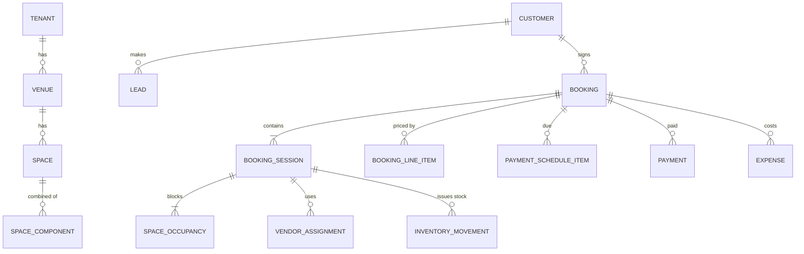

# 03 — Data model

Source of truth: `packages/db/prisma/schema.prisma` (39 models) plus
`packages/db/prisma/sql/001_constraints_and_rls.sql`. This doc explains the shape and the rules
behind it.

## Groups

| Group | Tables | Purpose |
| --- | --- | --- |
| Platform | `plans`, `tenants`, `subscriptions`, `tenant_counters` | SaaS plans, tenant settings, per-tenant numbering |
| Identity | `users`, `auth_sessions`, `auth_tokens`, `roles`, `memberships` | Login, sessions, one-time tokens, roles, user ↔ tenant |
| Venue setup | `venues`, `spaces`, `space_components`, `slot_templates`, `space_slot_prices`, `event_types` | Branches, halls, combined halls, shifts, base rents |
| Catalogue and pricing | `menu_items`, `packages`, `package_items`, `add_ons`, `price_rules`, `tax_rates`, `cancellation_policies`, `custom_field_defs` | Everything a quotation is built from |
| CRM | `customers`, `leads` | Customers and inquiries |
| Bookings | `bookings`, `booking_sessions`, `space_occupancies`, `booking_line_items` | Contract, functions, calendar blocks, frozen prices |
| Money | `payment_schedule_items`, `payments` | What is due and what was received/refunded |
| Operations | `vendors`, `vendor_assignments`, `expenses`, `inventory_items`, `inventory_movements` | Vendors per event, costs, stock ledger |
| Messaging and audit | `message_templates`, `message_logs`, `audit_logs` | Email templates, delivery log, change history |

## Key relationships

## Conventions

| Topic | Rule |
| --- | --- |
| IDs | `cuid()` strings. Never expose sequential IDs. Human numbers (`RB-2026-0142`) come from `tenant_counters` |
| Tenant column | `tenant_id` (snake_case in DB, `tenantId` in Prisma) on every tenant-owned table, including join tables |
| Money | `Decimal(14,2)`, currency = `bookings.currency` (copied from tenant at creation) |
| Instants | `timestamptz`. Slot start/end are venue-local `"HH:mm"` strings |
| Dates without time | `@db.Date` (due dates, price-rule ranges) |
| Flexible data | `Json` only for tenant settings, entitlements, custom field values, policy tiers. Anything we filter or join on gets a real column |
| Deletes | Catalogue: `active = false`. Bookings, payments, expenses, inventory movements, audit: never deleted |
| Immutability | `booking_line_items` are replaced as a set on re-quote (version bump), never edited in place after CONFIRMED except via a new version; `payments` and `inventory_movements` are append-only |
| Enums | Postgres enums via Prisma for closed sets the code branches on; free text for tenant-defined labels |

## Constraints and SQL that Prisma cannot express

All in `packages/db/prisma/sql/001_constraints_and_rls.sql`, pasted into the first migration:

1. `space_occupancies_no_overlap`: GiST exclusion constraint (space + time range, active rows).
2. `space_occupancies_valid_range`: `ends_at > starts_at`.
3. `bookings_sync_occupancy` trigger: status → occupancy `active` flag.
4. `enable_tenant_rls(table)` + policies on every `tenant_id` table.
5. `membership_self` and `tenant_visible` policies for the pre-tenant context.
6. `resolve_tenant(host)`: security-definer lookup for public pages.

`packages/db/tests/db-constraints.test.mjs` checks all of the above (17 checks), including
"every tenant_id table has forced RLS". It runs in CI on every change to `packages/db`.

## Adding a table (checklist)

1. Add the model with `tenantId String @map("tenant_id")` and a relation to `Tenant`.
2. `pnpm db:migrate --create-only`, then append to the generated `migration.sql`:
   `SELECT enable_tenant_rls('<table_name>');`
3. Add indexes that start with `tenant_id` for every list/filter query.
4. Run `pnpm --filter @venueos/db test:constraints`.
5. Add Zod schemas in `packages/shared` and update this doc's group table.

## Derived values (not stored)

| Value | How |
| --- | --- |
| Stock on hand | `SUM(qty)` of `inventory_movements` per item |
| Booking balance due | `grandTotal − paidTotal` (paidTotal maintained in the payment transaction) |
| Event profit | Booking revenue (line items, excl. tax) + vendor commission − expenses linked to the booking/sessions − damage value charged to the event |
| Event sheet | Query over session + package items + add-ons + vendor assignments + inventory movements |
