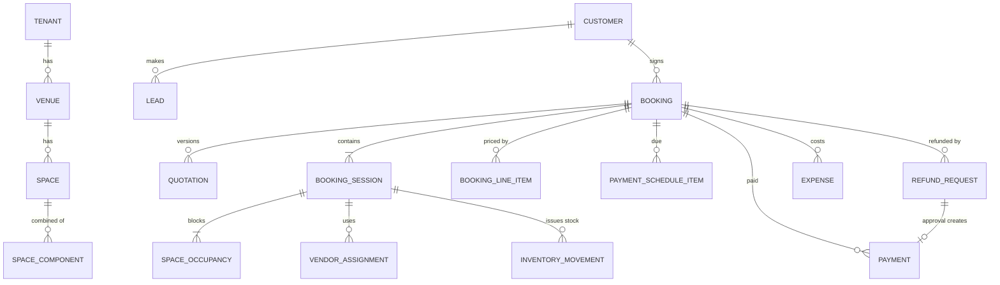

# 03 — Data model

Source of truth: `packages/db/prisma/schema.prisma` (44 models) plus
`packages/db/prisma/sql/001_constraints_and_rls.sql`. This doc explains the shape and the rules
behind it.

## Groups

| Group | Tables | Purpose |
| --- | --- | --- |
| Platform | `plans`, `tenants`, `subscriptions`, `tenant_counters` | SaaS plans, tenant settings, per-tenant numbering |
| Identity | `users`, `user_credentials`, `auth_sessions`, `auth_tokens`, `invitations`, `login_attempts`, `roles`, `memberships` | Login, sessions, one-time tokens, staff invitations, roles, user ↔ tenant |
| Venue setup | `venues`, `spaces`, `space_components`, `slot_templates`, `space_slot_prices`, `event_types` | Branches, halls, combined halls, shifts, base rents |
| Catalogue and pricing | `menu_items`, `packages`, `package_items`, `add_ons`, `price_rules`, `tax_rates`, `cancellation_policies`, `custom_field_defs` | Everything a quotation is built from |
| CRM | `customers`, `leads` | Customers and inquiries |
| Bookings | `bookings`, `quotations`, `booking_sessions`, `space_occupancies`, `booking_line_items` | Contract, quote versions, functions, calendar blocks, frozen prices |
| Money | `payment_schedule_items`, `payments`, `refund_requests` | What is due, what was received/refunded, refund approval |
| Operations | `vendors`, `vendor_assignments`, `expenses`, `inventory_items`, `inventory_movements` | Vendors per event, costs, stock ledger |
| Messaging and audit | `message_templates`, `message_logs`, `audit_logs` | Email templates, delivery log, change history |

## Key relationships

## Conventions

| Topic | Rule |
| --- | --- |
| Names | Tables **and columns** are `snake_case` in the database (`@@map` / `@map`); Prisma fields stay `camelCase`. Raw SQL always uses the snake_case names |
| IDs | `cuid()` strings. Never expose sequential IDs. Human numbers (`RB-2026-0142`) come from `tenant_counters` |
| Tenant column | `tenant_id` on every tenant-owned table, including join tables, with a relation to `Tenant` |
| Money | `Decimal(18,3)` for every amount. The currency is `bookings.currency` (copied from the tenant at creation). Rounding to the currency's ISO 4217 minor unit (PKR 2, KWD 3, JPY 0) happens in code through the map in `packages/shared`; the extra stored digit only exists so 3-decimal currencies fit |
| Amount signs | `payments.amount` and `expenses.amount` are always positive (CHECK > 0); `entry_type` decides the effect. `booking_line_items.amount` is **signed** with a CHECK per kind (DISCOUNT ≤ 0, ADJUSTMENT ±, RENT/PACKAGE/ADD_ON/TAX ≥ 0); totals are `SUM(amount)` |
| Payment status | Only `CHEQUE` may be `PENDING`/`BOUNCED`; all other methods are `CLEARED` on entry (CHECK) |
| Instants | Every `DateTime` is `timestamptz` (`@db.Timestamptz(6)`), UTC. Slot start/end and venue opening hours are venue-local `"HH:mm"` strings |
| Dates without time | `@db.Date` (due dates, price-rule ranges, `valid_until`) |
| Flexible data | `Json` only for tenant settings, entitlements, custom field values, policy tiers, quotation snapshots. Anything we filter or join on gets a real column |
| Files | Store the S3 object **key** (`pdf_key`, `receipt_key`, `photo_keys`), never a URL |
| Who did it | `created_by_id`, `received_by_id`, `requested_by_id`, `approved_by_id`, `invited_by_id` always hold a **user** id (`users.id`); `audit_logs` has `actor_type` + `actor_user_id` |
| Editable rows | Every editable table has `created_at`, `updated_at` and `rev`. A `touch_row` trigger sets `updated_at` and increments `rev` on every UPDATE. The API's `PATCH` sends `rev` back; a mismatch is `409 VERSION_CONFLICT`. (`bookings.quote_version` is the *price* version and is unrelated) |
| Deletes | Catalogue: `active = false`. Sessions: `status = CANCELLED`. Bookings, payments, refund requests, expenses, inventory movements, message logs, audit: never deleted (enforced, see privilege classes) |
| Immutability | `booking_line_items` are the current version only; every issued version is frozen in `quotations.line_items`. `payments`, `expenses`, `inventory_movements`, `audit_logs`, `message_logs` are append-only |
| Enums | Postgres enums via Prisma (`@@map` to snake_case type names) for closed sets the code branches on; free text for tenant-defined labels |
| Cross-tenant references | Composite `(tenant_id, id)` foreign keys for booking→customer, session→booking, session→space, occupancy→session, occupancy→space, payment→booking, quotation→booking. Every other client-supplied ID is loaded through `TenantDb` first (CLAUDE.md rule 13) |

## Privilege classes

`venueos_app` gets SELECT/INSERT/UPDATE/DELETE on every table by default; migrations narrow it:

| Class | Tables | `venueos_app` may |
| --- | --- | --- |
| Standard | everything not listed below | SELECT, INSERT, UPDATE, DELETE (catalogue "delete" is `active = false` by convention) |
| Append-only | `expenses`, `inventory_movements`, `audit_logs`, `message_logs` | SELECT, INSERT |
| Append-only, one column exception | `payments` | SELECT, INSERT, and `UPDATE (status, cleared_at)` for cheque clearing |
| No delete | `tenants`, `users`, `bookings`, `booking_sessions`, `quotations`, `refund_requests` | SELECT, INSERT, UPDATE |
| Read-only | `plans` | SELECT |
| Auth-only | `user_credentials`, `auth_sessions`, `auth_tokens`, `invitations`, `login_attempts` | nothing; `venueos_auth` has full DML. `users`: `venueos_auth` has SELECT/INSERT/UPDATE |
| Scanner | `tenants`, `venues`, `bookings`, `booking_sessions`, `payment_schedule_items`, `leads`, `inventory_items` | `venueos_jobs` has SELECT only (and BYPASSRLS) |

Because roles are declared in the migration SQL, the same behaviour applies in a throwaway CI
database, staging and production. A mistake is fixed with a reversing entry, never an edit.

## Constraints and SQL that Prisma cannot express

All in `packages/db/prisma/sql/001_constraints_and_rls.sql`, appended to the first migration
(`prisma/migrations/20261123073702_init`, which is now the source of truth; the file is a readable copy):

1. `space_occupancies_no_overlap`: GiST exclusion constraint (space + time range, active rows).
2. `space_occupancies_valid_range`, `booking_sessions_valid_range`: `ends_at > starts_at`.
3. Occupancy `active` is derived: a `BEFORE INSERT` trigger sets it from the booking and session
   status; `bookings_sync_occupancy` and `booking_sessions_sync_occupancy` triggers update it
   when either status changes. TENTATIVE/CONFIRMED/COMPLETED booking + ACTIVE session = active.
4. `bookings_number_required`: a held/confirmed/completed/expired booking has a number.
5. CHECKs: positive payment/refund/expense amounts, REVERSAL ↔ `reverses_id` linkage,
   `inventory_items.on_hand >= 0`, the per-type shape of `inventory_movements`.
6. Combined-space triggers: components are physical spaces of the same venue; combined spaces
   never nest (also checked when `is_combined` flips).
7. `touch_row` triggers (`rev` / `updated_at`) on every table that has a `rev` column.
8. `enable_tenant_rls(table)` + forced RLS and the `tenant_isolation` policy on every
   `tenant_id` table; `membership_self`, `tenant_visible` and `users_visible` policies for the
   pre-tenant context; `users_auth_all` and `auth_all` policies for `venueos_auth`.
9. `resolve_tenant(host)`: `SECURITY DEFINER`, owned by `venueos_definer` (`BYPASSRLS`),
   executable by `venueos_app` and `venueos_auth` only.
10. Role grants and the privilege classes above (helpers `make_append_only`, `revoke_delete`,
    `restrict_to_auth`).

`packages/db/tests/db-constraints.test.mjs` verifies all of the above against a **real
migrated schema** (not hand-written tables): it creates a throwaway database, applies the
schema as the non-superuser `venueos_migrator`, and exercises the app, auth and jobs roles.
It runs in CI on every change to `packages/db`.

## Prisma 7 setup (tasks P0-1 and P0-2)

- `generator client { provider = "prisma-client"  output = "../src/generated/prisma" }`; the
  datasource block has **no `url`**. The generated client is git-ignored. The lint rule that
  bans importing the Prisma client outside `packages/db` targets this generated path.
- `packages/db/prisma.config.ts` (`import "dotenv/config"`) sets
  `datasource.url = env("MIGRATE_DATABASE_URL")`, so `prisma migrate` and the seed always use
  `venueos_migrator`. `migrate dev` creates its shadow database with the migrator's
  `CREATEDB`; `migrate deploy` needs no shadow database.
- Runtime clients use driver adapters: `new PrismaClient({ adapter: new PrismaPg({ connectionString }) })`
  with `DATABASE_URL` (`venueos_app`, `TenantDb`), `AUTH_DATABASE_URL` (`venueos_auth`,
  `AuthDb`) and `JOBS_DATABASE_URL` (`venueos_jobs`, scanners). Verify the current Prisma 7
  docs for exact option names when scaffolding.
- **Gate (passed):** `set_config('app.tenant_id', …, true)` stays visible to later statements in
  the same `prisma.$transaction(async tx => …)` with the adapter and is gone for the next
  transaction on the pooled connection. Proved by `packages/db/tests/gate-set-config.test.ts`
  (`pnpm --filter @venueos/db test:gate`); re-run it after any Prisma or adapter upgrade.
- `@venueos/db` is built to `dist` (`prisma generate && tsc`) and exports `TenantDb`, `AuthDb`,
  `pgBossDb`, enums and model types; `PrismaClient` itself is not exported.
- `pnpm db:migrate` = `prisma migrate dev` (local; needs the migrator's `CREATEDB` for the shadow
  database), `pnpm --filter @venueos/db db:deploy` = `prisma migrate deploy` (staging/production).

## Adding a table (checklist)

1. Add the model: `@@map` snake_case table, `@map` snake_case columns, `tenantId String @map("tenant_id")`
   with a relation to `Tenant`, `createdAt`/`updatedAt` (`Timestamptz`) and `rev` if editable.
2. `pnpm db:migrate --create-only`, then append to the generated `migration.sql`:
   - `SELECT enable_tenant_rls('<table>');`
   - `SELECT enable_rev_trigger('<table>');` if it has `rev`/`updated_at`
   - its privilege class: `make_append_only`, `revoke_delete` or `restrict_to_auth` (or none)
   - needed CHECKs/triggers, and grants for `venueos_jobs` if a scanner reads it
3. Add indexes that start with `tenant_id` for every list/filter query, and an index on every
   foreign key you join or cascade on.
4. For references to parents that must be the same tenant, use composite
   `(tenant_id, id)` foreign keys (needs `@@unique([tenantId, id])` on the parent).
5. Extend `packages/db/tests/db-constraints.test.mjs` and run `pnpm --filter @venueos/db test:constraints`.
6. Add Zod schemas in `packages/shared` and update this doc's group table.

Data migrations and seeds that touch tenant tables run as `venueos_migrator`, which is subject
to forced RLS like everyone else: set `app.tenant_id` (and `app.user_id` for `users`) before
writing, or insert users/credentials through `venueos_auth`. For a one-off cross-tenant data fix,
`SET ROLE venueos_definer` (the migrator is a member) inside the migration, with explicit GRANTs.

## Derived and computed values

| Value | How |
| --- | --- |
| Stock on hand | **Stored** in `inventory_items.on_hand` (CHECK >= 0), changed in the same transaction as the movement, after `SELECT ... FOR UPDATE` on the item row. The ledger invariant `on_hand = SUM(stock_delta)` is not enforced by a constraint; the nightly `inventory.reconcile` job checks it and alerts the branch manager (the constraint tests prove the issue 10 / return 8 / damaged 2 example) |
| Session stock reconciliation | issued (`−ΣISSUE.stock_delta`) = `Σreturned_qty + Σdamaged_qty` over the session's movements |
| Booking balance due | `grandTotal − paidTotal` (`paidTotal` maintained in the payment transaction) |
| Paid total | `Σ` of CLEARED `RECEIPT` payments − CLEARED `REFUND` payments, where a `REVERSAL` negates the entry it points to |
| Schedule item paid/unpaid | **FIFO**: received payments are applied to schedule items by due date; no allocation table |
| Event profit | Booking revenue (line items, excl. tax) + vendor commission − expenses linked to the booking/sessions (reversals net out) − damage value (`damaged_qty × unit_cost` snapshot on the RETURN, plus session-linked DAMAGE) charged to the event |
| Event sheet | Query over session + package items + add-ons + vendor assignments + inventory movements |
